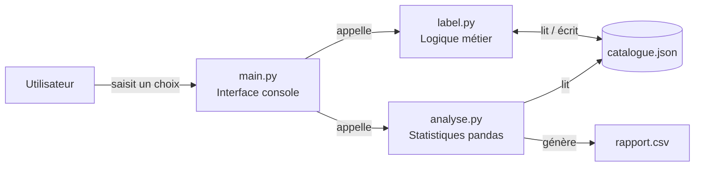

# 🎵 SahelSound Records

Application console en **Python** pour gérer le catalogue d'un label musical africain :
consulter les artistes, ajouter des artistes et des albums, puis produire des
statistiques et un rapport CSV.

Projet réalisé dans le cadre d'un TP de programmation Python.
Les données sont stockées dans un simple fichier **JSON**, les statistiques sont
calculées avec **pandas**.


---

## 1. Présentation

### Contexte

SahelSound Records est un label musical qui produit des artistes africains
(Afrobeat, Afropop, Mbalax, Hip-hop, Coupé-Décalé, etc.).
Le label veut arrêter de gérer son catalogue dans un tableur et dispose d'un
budget limité : la solution choisie est une **application console** simple,
rapide et sans base de données à installer.

### Problème à résoudre

- Centraliser les informations des artistes et de leurs albums.
- Éviter les doublons d'identifiants et les saisies incomplètes.
- Pouvoir répondre rapidement à des questions comme :
  - Quels sont les artistes les plus écoutés ?
  - Quels genres ont le plus de streams en moyenne ?
  - Combien d'albums sont sortis chaque année ?

### Objectif de l'application

Fournir un outil en ligne de commande qui permet de **consulter**, **modifier**
et **analyser** le catalogue, avec une sauvegarde automatique dans
`catalogue.json` après chaque modification.

### Public cible

- Le responsable du label (utilisation quotidienne).
- Un assistant / stagiaire qui met à jour les albums.

---

## 2. Cahier des charges

### 2.1 Périmètre

| Inclus (MVP) | Hors périmètre (v1) |
|---|---|
| Application console Python | Interface graphique ou web |
| Catalogue dans un fichier JSON | Base de données serveur (MySQL, PostgreSQL…) |
| Ajout d'artistes et d'albums | Suppression / modification d'un artiste existant |
| Statistiques avec pandas | Authentification et gestion des utilisateurs |
| Export d'un rapport CSV | Connexion aux API Spotify / Deezer / YouTube |
| 12 artistes de démonstration | Gestion des droits, des contrats ou de la comptabilité |

### 2.2 Acteurs

| Acteur | Rôle |
|---|---|
| **Utilisateur** | Choisit une option dans les menus et saisit les informations |
| **Système** | Valide les saisies, met à jour le JSON, calcule les statistiques |

### 2.3 Besoins fonctionnels

| ID | Fonctionnalité | Description | Priorité |
|---|---|---|---|
| **F1** | Consulter le catalogue | Afficher la liste des artistes, rechercher par nom ou genre, afficher le détail et les albums d'un artiste | Haute |
| **F2** | Ajouter un artiste | Saisir `id`, `nom`, `genre`, `pays`, vérifier l'unicité de l'identifiant puis sauvegarder | Haute |
| **F3** | Ajouter un album | Saisir `titre`, `annee`, `streams` pour un artiste identifié par son `id`, puis sauvegarder | Haute |
| **F4** | Statistiques | Afficher le top 5 des artistes, la moyenne des streams par genre et le nombre d'albums par année | Haute |
| **F5** | Exporter un rapport | Générer `rapport.csv` à partir des statistiques | Moyenne |
| **F6** | Quitter | Fermer proprement l'application | Haute |

#### Détail de F1 — Consulter le catalogue

| Sous-option | Comportement attendu |
|---|---|
| `a` Afficher tous les artistes | Tableau avec nom, genre, pays et nombre d'albums |
| `b` Rechercher un artiste | Recherche par `nom` ou `genre`, insensible à la casse et partielle |
| `c` Détail d'un artiste | Fiche de l'artiste + tableau de ses albums (titre, année, streams) |

#### Détail de F4 — Statistiques

| Statistique | Calcul |
|---|---|
| Top 5 artistes | Somme des streams de tous les albums d'un artiste, tri décroissant, 5 premiers |
| Moyenne par genre | Moyenne des streams des albums, regroupée par `genre`, arrondie à l'entier |
| Albums par année | Nombre d'albums dont l'année de sortie correspond, tri par année |

### 2.4 Règles de gestion

| ID | Règle |
|---|---|
| **RG1** | L'identifiant d'un artiste est **obligatoire** et **unique** (format conseillé : `ART-013`). |
| **RG2** | Le nom, le genre et le pays sont obligatoires et ne peuvent pas être vides. |
| **RG3** | Le titre d'un album est obligatoire. |
| **RG4** | L'année de sortie est un entier **≥ 1900** ; les streams sont un entier **≥ 0**. |
| **RG5** | Toute création (artiste ou album) est **sauvegardée immédiatement** dans `catalogue.json`. |
| **RG6** | La recherche est insensible à la casse et accepte une partie du texte (`fally` → `Fally Ipupa`). |
| **RG7** | Le catalogue est lu et écrit en **UTF-8** pour conserver les accents (`Sénégal`, `Coupé-Décalé`). |
| **RG8** | Une erreur de saisie affiche un message clair et ne modifie pas le fichier JSON. |

### 2.5 Modèle de données

Le catalogue est une **liste d'artistes**. Chaque artiste contient une liste
d'albums :

```json
[
  {
    "id": "ART-001",
    "nom": "Fally Ipupa",
    "genre": "Afrobeat",
    "pays": "RDC",
    "albums": [
      { "titre": "Tokooos", "annee": 2017, "streams": 6800000 }
    ]
  }
]
```

| Champ | Type | Obligatoire | Exemple |
|---|---|---|---|
| `id` | chaîne | Oui | `"ART-001"` |
| `nom` | chaîne | Oui | `"Fally Ipupa"` |
| `genre` | chaîne | Oui | `"Afrobeat"` |
| `pays` | chaîne | Oui | `"RDC"` |
| `albums` | liste | Oui (peut être vide) | `[]` |
| `albums[].titre` | chaîne | Oui | `"Tokooos"` |
| `albums[].annee` | entier | Oui | `2017` |
| `albums[].streams` | entier | Oui | `6800000` |

### 2.6 Contraintes techniques

- **Langage** : Python 3.10 ou plus récent.
- **Bibliothèques** : `pandas` pour les statistiques ; le reste avec la
  bibliothèque standard (`json`).
- **Interface** : console uniquement, menus numérotés.
- **Stockage** : fichier `catalogue.json` local, encodage UTF-8.
- **Environnement** : Linux, macOS ou Windows.

### 2.7 Critères d'acceptation (recette)

| # | Scénario | Résultat attendu |
|---|---|---|
| 1 | Menu `1` puis `a` | Les 12 artistes sont affichés avec leur nombre d'albums |
| 2 | Menu `1` puis `b`, critère `nom`, valeur `fally` | Fally Ipupa est affiché |
| 3 | Menu `1` puis `c`, nom `Aya Nakamura` | Aya Nakamura et ses 3 albums sont affichés |
| 4 | Menu `2` avec l'id `ART-001` | Message « L'identifiant existe déjà » et aucune modification |
| 5 | Menu `2` avec un id et des champs valides | Artiste ajouté et présent dans `catalogue.json` |
| 6 | Menu `3` avec l'année `abc` | Message d'erreur, puis nouvelle demande jusqu'à une saisie correcte |
| 7 | Menu `3` avec un id inconnu | Message « Aucun artiste avec l'identifiant… » |
| 8 | Menu `4` puis `o` | Les 3 tableaux sont affichés et `rapport.csv` est créé |
| 9 | Menu `5` | Le programme se termine par « Au revoir ! » |
| 10 | Suppression de `catalogue.json` | Message d'erreur clair, pas de traceback |

---

## 3. Architecture du projet

Le code est séparé en trois couches : **interface**, **logique métier** et
**analyse**. C'est le principe de séparation des responsabilités : chaque fichier
a un rôle simple à comprendre.

| Fichier | Rôle |
|---|---|
| `main.py` | Menus, saisies utilisateur, affichage. Point d'entrée du programme. |
| `label.py` | Logique métier : charger/sauvegarder le JSON, lister, rechercher, ajouter. |
| `analyse.py` | Statistiques pandas et export CSV. |
| `catalogue.json` | Données du catalogue (12 artistes de démonstration). |
| `requirements.txt` | Dépendances Python à installer. |
| `rapport.csv` | Rapport généré par l'option 4 (non versionné). |
| `aide.py`, `aide2.py` | Anciens brouillons de travail, conservés pour l'historique. |



### Répartition des responsabilités

- `main.py` ne manipule pas directement le JSON : il appelle les fonctions de
  `label.py`.
- `label.py` ne fait aucun `print` de menu : il lève des exceptions `ValueError`
  que `main.py` transforme en messages lisibles.
- `analyse.py` ne modifie jamais les données : il lit le fichier et renvoie des
  `DataFrame`.

---

## 4. Installation et lancement

### Prérequis

- Python 3.10 ou plus récent (`python3 --version`).
- `pip`.

### Étapes

```bash
# 1. Cloner le dépôt
git clone https://github.com/<votre-compte>/SahelSound-Records.git
cd SahelSound-Records

# 2. Créer un environnement virtuel (recommandé)
python3 -m venv .venv
source .venv/bin/activate        # Windows : .venv\Scripts\activate

# 3. Installer les dépendances
pip install -r requirements.txt

# 4. Lancer l'application
python main.py
```

> Les options 1 à 3 fonctionnent même sans pandas.
> L'option 4 affiche un message d'installation si pandas est absent.

---

## 5. Utilisation

```text
      *** SahelSound Records ***

BIENVENUE, voici les menus principaux disponibles :
1. Consulter le catalogue
2. Ajouter un artiste
3. Ajouter un album à un artiste existant
4. Statistiques et rapport
5. Quitter l'application
Votre choix (1 à 5) :
```

### Exemple : ajouter un album

```text
Votre choix (1 à 5) : 3

*** Ajouter un album ***
a. Recherche de l'artiste par son identifiant
b. Saisie des informations de l'album
c. Mise à jour de catalogue.json
Identifiant de l'artiste (ex : ART-013) : ART-001
Titre de l'album : Nouvel album
Année de sortie : 2026
Nombre de streams : 2500000
Album 'Nouvel album' ajouté avec succès !
```

L'album est immédiatement écrit dans `catalogue.json`.

---

## 6. Rapport produit

L'option `4` affiche trois tableaux, puis propose de générer `rapport.csv`.

Exemple avec les données fournies :

```text
*** Top 5 des artistes par streams ***
          Artiste  Total streams
        Burna Boy       37600000
           Davido       33200000
     Aya Nakamura       33100000
      Fally Ipupa       16100000
Dip Doundou Guiss       11300000
```

Le fichier `rapport.csv` contient trois sections séparées par un titre :
`TOP 5 DES ARTISTES PAR STREAMS`, `MOYENNE DES STREAMS PAR GENRE` et
`ALBUMS PAR ANNEE`. Il est encodé en UTF-8 avec BOM (`utf-8-sig`) pour s'ouvrir
correctement dans Excel.

---

## 7. Bugs corrigés

Ce projet a d'abord été écrit en plusieurs étapes. Voici les problèmes corrigés
lors de la remise au propre :

| # | Bug | Correction |
|---|---|---|
| 1 | `main.py` utilisait `label` et `CHEMIN_JSON` sans les définir (`NameError`) | Utilisation de l'alias importé `lb` et de la constante `CHEMIN_CATALOGUE` |
| 2 | Les options 2, 3 et 4 du menu principal n'étaient pas branchées | Ajout des appels `menu_ajouter_artiste`, `menu_ajouter_album`, `menu_statistiques` |
| 3 | `label.ajouter_artiste` / `ajouter_album` renvoyaient un texte au lieu du catalogue | Elles renvoient maintenant le catalogue et lèvent `ValueError` en cas d'erreur |
| 4 | `label.charger_catalogue` renvoyait `None` si le fichier manquait | Elle lève une exception claire, interceptée au démarrage |
| 5 | Un critère de recherche invalide renvoyait silencieusement une liste vide | `ValueError` explicite et validation du critère dans le menu |
| 6 | `analyse.py` appelait `.columns` sur une `Series` pandas | Ajout de `.reset_index()` avant de renommer les colonnes |
| 7 | `analyse.py` plantait sur un catalogue vide | Retour de `DataFrame` vides avec les bonnes colonnes |
| 8 | Identifiants incohérents `ART002` et `ART007` | Normalisés en `ART-002` et `ART-007` |
| 9 | Titres issus du PDF collés (`AfricanGiant`, `A GoodTime`, `LeGriot Moderne`) | Corrigés en `African Giant`, `A Good Time`, `Le Griot Moderne` |
| 10 | `main()` était exécuté à l'import du fichier | Protégé par `if __name__ == "__main__":` |
| 11 | Les erreurs de saisie numérique affichaient un message technique | Fonction `demander_entier()` avec message compréhensible |

---

## 8. Pistes d'amélioration

- Ajouter la **modification** et la **suppression** d'un artiste ou d'un album.
- Générer automatiquement le prochain identifiant (`ART-013`, `ART-014`…).
- Empêcher d'ajouter deux fois le même album pour un artiste.
- Ajouter des **tests unitaires** avec `pytest`.
- Remplacer le JSON par **SQLite** si le catalogue devient volumineux.
- Proposer des graphiques (`matplotlib`) ou une petite interface web (`Flask`).
- Exporter un vrai CSV unique ou un fichier Excel multi-feuilles.

---

## 9. Auteur

Projet — **SahelSound Records**.
TP Python : manipulation de fichiers JSON, séparation en modules, utilisation de
pandas pour l'analyse de données.
